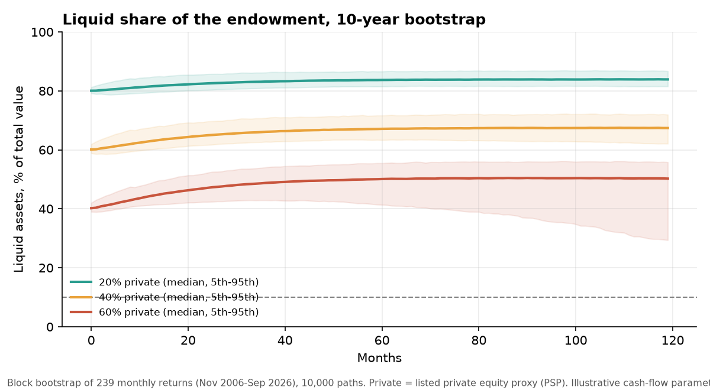
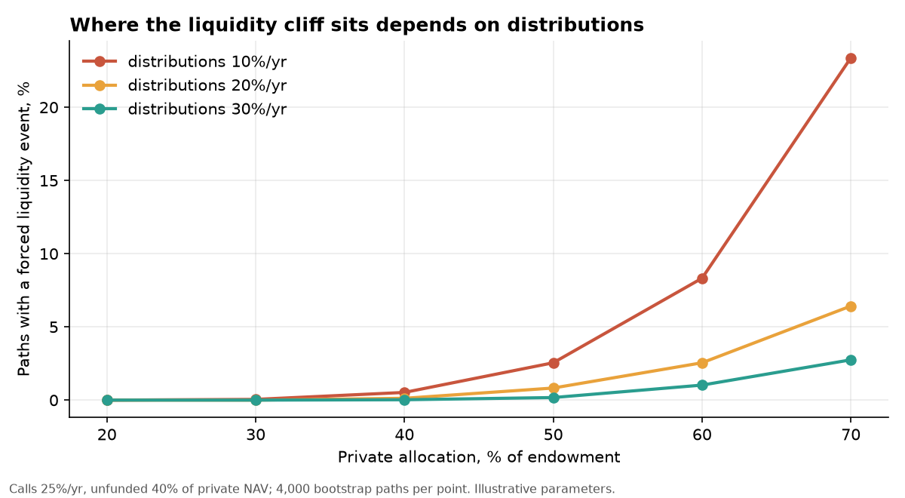
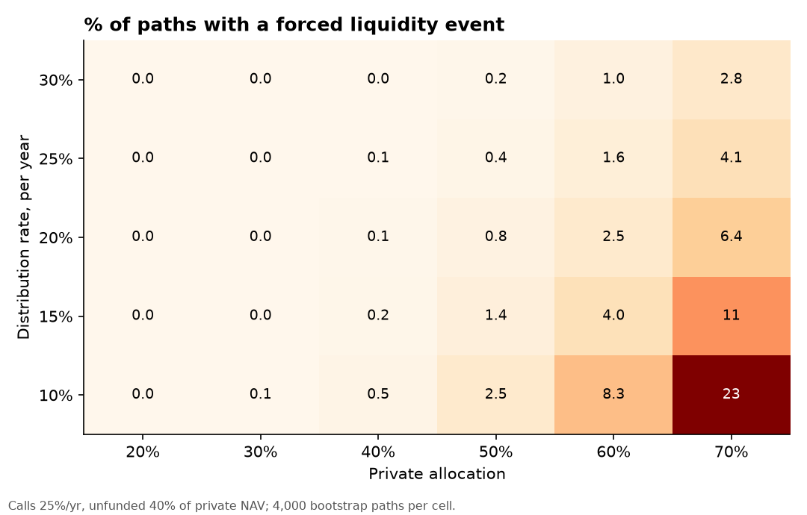
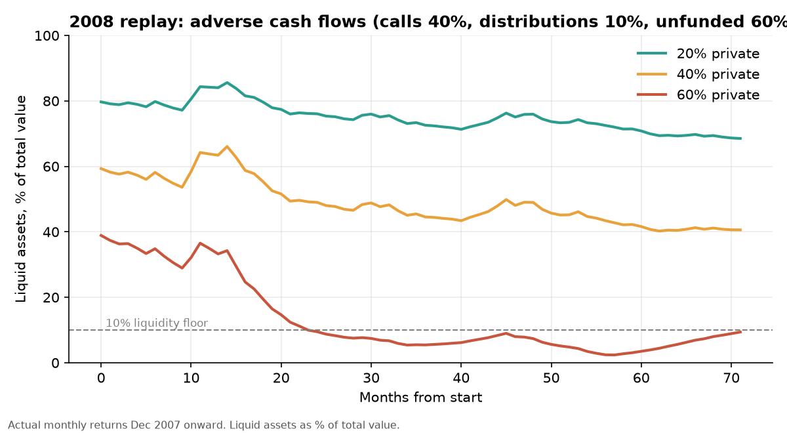

# How much private equity can an endowment hold before it runs out of cash?

A liquidity stress test of an endowment with private-asset commitments, built on public data
(Nov 2006 to Sep 2026). It asks one question: at what private allocation does the endowment
start to run short of liquid assets to fund spending and capital calls, and what decides that?

**Short answer:** below about 40% private, almost nothing breaks (forced liquidity events in
0.0% of 10-year paths at 20% private, 0.2% at 40%). At 60% it is 2.5%, and 18% of paths fall to
under two years of liquid cover. Above 40% the outcome depends mostly on one assumption:
how fast private distributions dry up in a downturn. Cutting distributions from 20% to 10% a
year takes the 60% case from 2.5% to 8.3%, and slow distributions combined with fast capital
calls and large unfunded commitments take it to 28%.



## Method

- **Cash-flow engine** (`src/model.py`): in the style of Takahashi and Alexander's endowment
  model. Each month: returns, then capital calls (a share of unfunded commitments), distributions
  (a share of private NAV that falls when private returns have been poor), then spending, then
  new commitments to hold the target private allocation. New commitments stop when the endowment
  shrinks; calls do not.
- **Spending** is a smoothed rule (80% prior spend grown with inflation, 20% a 5% target of
  value), updated annually.
- **Failure measures:** forced event = the liquid pool cannot fund spending plus calls in some
  month; floor breach = liquid assets below 10% of total value; cover below 2 = liquid assets
  below two years of spending plus expected calls.
- **Returns:** moving-block bootstrap (6-month blocks) of the six-sleeve monthly return vector,
  so crash correlations are the ones actually observed. 10,000 paths, 10-year horizon.
- **Sleeves:** equity 50% SPY / 30% EFA / 20% EEM, bonds AGG, real assets VNQ, private equity PSP
  (listed private equity), cash from the FRED 3-month T-bill rate, inflation from FRED CPI.
  Liquid part is 60% equity, 20% bonds, 10% real assets, 10% cash.
- **Baseline cash flows:** calls 25%/yr of unfunded, distributions 20%/yr of private NAV,
  unfunded commitments 40% of private NAV. These are illustrative. The grid below shows how much
  they matter.

## Results

### Baseline (10-year bootstrap, 10,000 paths)

| Private allocation | Forced event | Floor breach | Liquid cover below 2 years | Median min cover (years) |
|---|---|---|---|---|
| 20% | 0.0% | 0.0% | 0.0% | 8.1 |
| 40% | 0.2% | 0.2% | 1.4% | 4.8 |
| 60% | 2.5% | 3.1% | 18.1% | 2.8 |

Simulation error on the 60% forced rate is about ±0.3 points. That reflects the 10,000 paths
only, not uncertainty in the assumptions or in 239 months of data.

### What drives it



Share of paths with a forced event at 60% private, changing one assumption at a time:

| Scenario | Forced | Floor breach |
|---|---|---|
| Baseline | 2.5% | 3.1% |
| Calls 40%/yr | 3.5% | 4.6% |
| Distributions 10%/yr | 8.3% | 11.2% |
| Unfunded 60% of private NAV | 5.6% | 7.3% |
| All three | 27.9% | 49.7% |

Weight against distribution rate (forced %, calls 25%, unfunded 40%):

| Distribution rate | 40% private | 50% | 60% | 70% |
|---|---|---|---|---|
| 10%/yr | 0.5 | 2.6 | 8.3 | 23.4 |
| 20%/yr | 0.1 | 0.8 | 2.6 | 6.4 |
| 30%/yr | 0.0 | 0.2 | 1.0 | 2.8 |



### Historical replays (actual monthly returns, no bootstrap)

| Episode | Cash flows | 60% private: lowest liquid share | Lowest cover (years) |
|---|---|---|---|
| 2008-09 (from Dec 2007, 72 months) | Baseline | 40.4% | 2.1 |
| 2008-09 | Adverse (calls 40%, distributions 10%, unfunded 60%) | 2.4% | 0.2 |
| 2022 rate shock (from Jan 2022, 57 months) | Baseline | 39.8% | 2.8 |
| 2022 | Adverse | 14.2% | 1.0 |

No replay produces a forced event, but the 2008 adverse case at 60% private comes within 2.4%
of total value of running out of liquid assets.



### Robustness (forced event rate, 60% private)

Baseline 2.5%. Block length 3 months 1.1%, 12 months 2.3%. Smoother private marks (0.7x
volatility) 1.1%. Spend rate 4% 1.1%, 6% 4.9%. Liquid mix with 40% equity 1.3%. Lifting the
private proxy's mean return to the equity sleeve's mean 1.6%. The direction is stable: stress
rises with private weight and falls with faster distributions. The level moves by a factor of
two or more with each assumption, so treat the rates as illustrative.

## What this does not show

- It is not a forecast for any real endowment. Real endowments hold a mix of buyout, venture and
  real assets, can sell stakes on the secondary market and issue debt, none of which is modelled.
  That makes "forced event" here an upper-bound style measure, not a default probability.
- The private sleeve is **listed** private equity (PSP), which is market-priced and more volatile
  than reported fund NAVs. It compounded at only 1.9% a year over this sample, below inflation.
  Making it better makes stress smaller, not larger (robustness row above), so this baseline is not
  flattering the result, but it is still a proxy.
- Cash-flow parameters (call rate, distribution rate, unfunded share) are illustrative, not
  calibrated to a named fund or endowment. The grid is the honest answer to "what if they are
  different".
- 239 monthly observations contain essentially three stress episodes (2008-09, 2020, 2022). A
  bootstrap cannot produce a worse crisis than the sample contains.
- Real spending falls 12-17% in the median path in every scenario. That is the smoothing rule
  tracking market values and inflation, not a liquidity effect.
- Hedge-fund sleeve excluded: the best free proxy (QAI) starts in 2009.
- This is research, not investment advice.

## Verification

`verify.py` re-implements the engine in plain Python, one path at a time, and compares it with
the vectorised model on 1,818 path and parameter combinations (historical replays and
bootstrap paths). The largest difference is 4e-14. This checks the code against the stated
rules, not the rules themselves.

## Data handling

- Month-end total-return adjusted closes from Yahoo Finance. The incomplete current month is
  dropped.
- FRED CPI for October 2025 is missing (it was never published); interpolated linearly.
- Common sample starts November 2006 because PSP starts October 2006.

## Reproduce

```
pip install -r requirements.txt
set FRED_API_KEY=your_key        # PowerShell: $env:FRED_API_KEY="your_key"
python fetch_data.py             # writes data/raw/*.csv
python run_all.py                # about 1 minute; writes results/ and figures/
python verify.py                 # independent check
```
